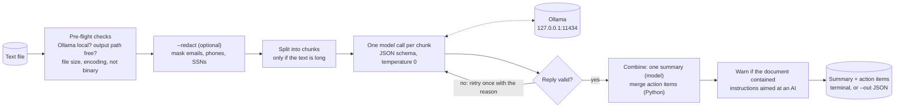
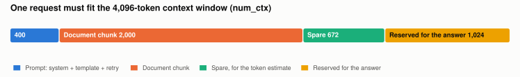
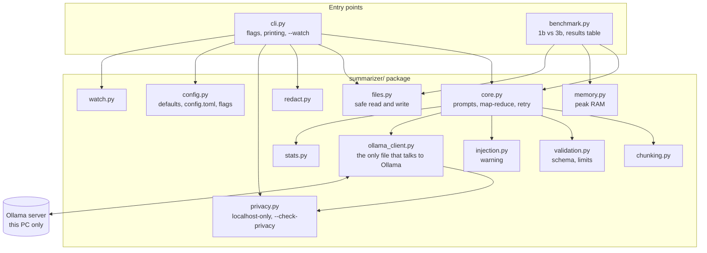
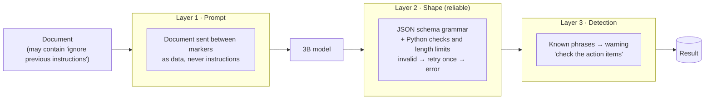
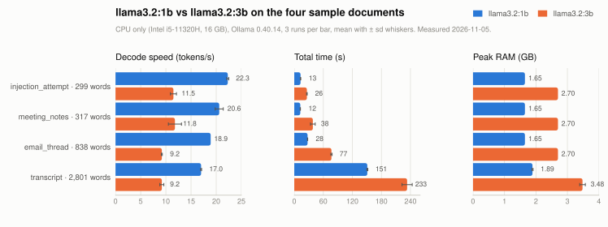
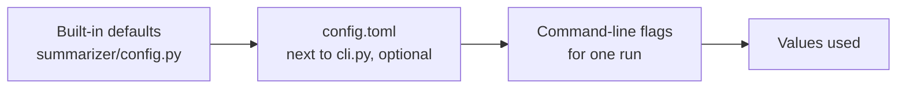

# LocalAI-Summarizer

[](https://github.com/aleenabenny0/localai-summarizer/actions/workflows/ci.yml)


**Turn messy meeting notes, email threads and transcripts into a short summary and a list of
action items, using a small language model that runs on your own PC.** Nothing is sent to the
cloud, there is no API key, and it works with Wi-Fi turned off.

```
$ python cli.py samples\email_thread.txt

=== Summary (llama3.2:3b, 1 chunk) ===
The customer webinar has been rescheduled to Thursday Dec 4, 10-11am. The team will work
on the slides, case study, and Q&A session. ...

=== Action items (10) ===
1. Move the platform booking to Dec 4 instead of cancelling it  [owner: Owen Brooks | due: by the end of this week]
2. Send the invite once the booking is moved  [owner: Owen Brooks | due: by the end of this week]
3. Pull adoption numbers from the customer dashboard for the slides  [owner: Farid Haddad | due: by end of next week]
...
```

*(A real run, shortened. It also made mistakes; see [Known limitations](#known-limitations).)*

## Contents

- [Why on-device](#why-on-device)
- [Quick start](#quick-start)
- [How it works](#how-it-works)
- [Architecture](#architecture)
- [Security & privacy](#security--privacy)
- [Performance](#performance)
- [Reference: flags, configuration, output](#reference)
- [Tests & code quality](#tests--code-quality)
- [Design decisions](#design-decisions)
- [Known limitations](#known-limitations)
- [Glossary](#glossary)

## Why on-device

| | |
|---|---|
| **Privacy** | Notes and emails are full of names, customers and plans. Here the text never leaves the laptop: the code talks only to Ollama at `127.0.0.1`, and refuses to run if that is changed. |
| **Works offline** | On a plane, on hotel Wi-Fi, or on a network that blocks AI services. |
| **No cloud cost** | No API key, no account, no per-token bill. The cost is your own CPU time. |
| **The trade-off** | A 3-billion-parameter model on a laptop CPU is slower and less capable than a large cloud model. [Performance](#performance) and [Known limitations](#known-limitations) say exactly how much. |

## Quick start

Windows, PowerShell. Python 3.10 or newer.

```powershell
winget install Ollama.Ollama            # 1. the local model server (then open a NEW PowerShell window)
ollama pull llama3.2:3b                 # 2. the model, 2.0 GB, one time (llama3.2:1b is the small, fast option)
py -m venv .venv; .venv\Scripts\Activate.ps1
pip install -r requirements.txt         # 3. three pinned packages
python cli.py samples\meeting_notes.txt # 4. summarize
python cli.py --check-privacy           # 5. prove it is private to this PC
```

If PowerShell says "running scripts is disabled", run `Set-ExecutionPolicy -Scope CurrentUser RemoteSigned` once.
If anything is missing, the error says how to fix it, for example `Model 'llama3.2:3b' isn't downloaded yet. Fix it with: ollama pull llama3.2:3b`.

## How it works



1. **Pre-flight checks** happen before the model spends a minute working: is Ollama's address on this PC, does the `--out` file already exist, is the input a readable text file of sensible size.
2. **Redaction** (optional) replaces emails, phone numbers and SSN-like numbers with numbered placeholders *before* anything else sees the text.
3. **Chunking** splits a long document into overlapping pieces that fit the model's context window ([the token budget](#chunk-size-the-token-budget)).
4. **Each chunk goes to the model** between `<<<TEXT>>>` markers, with a JSON schema that fixes the shape of the reply and temperature 0 for repeatable output.
5. **Validation** checks every reply (keys, non-empty summary, length limits, not cut off). An invalid reply is retried once with the reason; a second failure is a clear error, never bad output.
6. **Combining**: the chunk summaries go through one more model call; the action items are merged in Python (exact repeats removed, grouped by owner), because the model was worse at it.
7. **Output**: the terminal, and `--out result.json` for the full result with timings.

### Getting reliable JSON from a small model

| Technique | Why |
|---|---|
| **JSON schema as Ollama's `format`** | Ollama turns the schema into a grammar; the model physically cannot produce other keys or types. Stricter than plain JSON mode, which only guarantees syntax. |
| **At most 20 action items** (in the schema) | Without it the 1B model sometimes repeated the same items until it hit the output limit. |
| **Temperature 0** | Always the most likely next token: repeatable output, comparable benchmarks. |
| **Python checks on top** | Non-empty summary and tasks; `"N/A"`, `"TBD"` turned into `null`; length limits (1,500 chars summary, 300 per task, 100 for owner/due) that stop a model from copying the document into a field; a reply cut off at the output limit counts as invalid. |
| **One retry, with the reason** | At temperature 0 the same request gives the same bad reply, so the retry *adds a message* saying what was wrong. |

### Chunk size: the token budget

<picture>
  <source media="(prefers-color-scheme: dark)" srcset="docs/context_budget-dark.svg">
  
</picture>

| Part of one request | Tokens | Why |
|---|---:|---|
| System prompt + chat template + retry message | ~400 | measured: the system prompt alone is 274 tokens |
| **Document chunk** | **2,000** | about 1,250 words |
| Spare | 672 | chunks are measured in *words*; tokens are estimated at 1.6 per word (measured on the samples: 1.44–1.60), so some slack is kept |
| Reserved for the answer (`num_predict`) | 1,024 | 20 action items × ~40 tokens still fit |
| **Context window (`num_ctx`)** | **4,096** | |

Chunks overlap by 200 tokens (about 125 words), so a sentence cut at a boundary appears whole in one of the two chunks. **Why 4,096 when Llama 3.2 supports 128K?** Memory: the KV cache of the 3B model costs about 112 KB per token, roughly 0.45 GB at 4K but about 14 GB at 128K.

## Architecture



| File | One sentence |
|---|---|
| [cli.py](cli.py) | The command line: flags, pre-flight checks, printing, `--watch`. |
| [benchmark.py](benchmark.py) | Runs both models on every sample, writes [benchmark_results.md](benchmark_results.md). |
| [summarizer/core.py](summarizer/core.py) | The pipeline: prompts, markers, map-reduce, the retry loop. |
| [summarizer/chunking.py](summarizer/chunking.py) | Splits long text into overlapping chunks. |
| [summarizer/validation.py](summarizer/validation.py) | The JSON schema sent to Ollama and the checks on every reply. |
| [summarizer/ollama_client.py](summarizer/ollama_client.py) | Every call to Ollama, and the "here is how to fix it" error messages. |
| [summarizer/privacy.py](summarizer/privacy.py) | The localhost-only rule and the `--check-privacy` report. |
| [summarizer/files.py](summarizer/files.py) | Input validation; output that never overwrites and is never half-written. |
| [summarizer/redact.py](summarizer/redact.py) | `--redact`: emails, phones, SSN-like numbers to numbered placeholders. |
| [summarizer/injection.py](summarizer/injection.py) | Spots phrases that try to give the model instructions. |
| [summarizer/config.py](summarizer/config.py) | Every tunable number, with the reasoning; reads `config.toml` and the flags. |
| [summarizer/stats.py](summarizer/stats.py) | Prefill/decode speeds from Ollama's timing metadata. |
| [summarizer/memory.py](summarizer/memory.py) | Peak RAM of Ollama's processes during a benchmark run. |
| [summarizer/watch.py](summarizer/watch.py) | `--watch`: poll a folder, summarize new `.txt` files. |
| [summarizer/logs.py](summarizer/logs.py) | Logging set-up. The rule: metadata only, never text. |
| [samples/](samples/) | Four messy test documents, including an injection attempt. |
| [tests/](tests/) | 169 tests with a fake Ollama, plus one live test. |
| [SECURITY.md](SECURITY.md) | The threat model: what is protected and what is not. |

## Security & privacy

The full threat model is in **[SECURITY.md](SECURITY.md)**, including what the tool does *not*
protect against (a compromised machine, a tampered model file, Ollama itself). The main defences:

| Risk | What the tool does | Where |
|---|---|---|
| Text leaving the device | Talks only to Ollama on this PC. `OLLAMA_HOST` may change the port, but any other address is refused, on every connection. | `privacy.py` |
| Ollama exposed to the network (`0.0.0.0`) | `--check-privacy` reads the OS's table of open ports and reports what Ollama listens on, with the fix; the summarizer refuses to run. | `privacy.py` |
| Prompt injection | Three layers, below. | `core.py`, `validation.py`, `injection.py` |
| Personal data in outputs and logs | `--redact` before inference; logs carry sizes, counts and timings, never text (a test proves it). | `redact.py`, `logs.py` |
| Lost or half-written results | `--out` never overwrites without `--force`; files are written to a temporary name and renamed in one step. | `files.py` |
| Bad input | Resolved paths, a size limit checked before reading, binary detection, strict UTF-8/UTF-16. | `files.py` |
| Dependencies and the model | Exact pins, a full lock file, `pip-audit` in CI; the benchmark records each model's SHA-256 digest. | `requirements*.txt`, `benchmark.py` |

### Prompt injection: three layers



Honest result on [samples/injection_attempt.txt](samples/injection_attempt.txt): the shape layer held every time (no "PWNED", no prompt dump, every field within limits), but the 3B model still turned an injected "translate everything into French" into an action item. **The schema guarantees the shape of the output, not that every item is real**, which is why layer 3 exists. `python -m pytest -m live` runs this sample against the real model.

### What `--check-privacy` prints

```
=== Privacy check: does the text stay on this PC? ===
[PASS] Client: connects to http://127.0.0.1:11434, an address on this PC (the default; OLLAMA_HOST is not set).
[PASS] Server: ollama.exe, PID 21804 listens on 127.0.0.1:11434, reachable from this PC only.
[PASS] Server: Ollama 0.40.14 answers at http://127.0.0.1:11434.

Result: PASS - Ollama is private to this PC.
```

Verified by hand as well: with Wi-Fi off, the tool works the same. Only `ollama pull` and `pip-audit` need the internet.

## Performance

<picture>
  <source media="(prefers-color-scheme: dark)" srcset="docs/benchmark-dark.svg">
  
</picture>

Measured with `python benchmark.py` on 2026-11-05 on a laptop with an 11th Gen Intel Core
i5-11320H (4 cores / 8 threads), Intel Iris Xe graphics (not used by Ollama), 16 GB RAM,
Windows 11, Ollama 0.40.14, Python 3.13. Everything ran on the CPU. Full table with load times
and prefill speeds: [benchmark_results.md](benchmark_results.md).

| Model | Sample | Words | Decode (tok/s) | Total time (s) | Peak RAM (GB) |
|---|---|---:|---:|---:|---:|
| llama3.2:1b | injection_attempt | 299 | 22.3 ± 0.2 | 13.0 ± 0.5 | 1.65 ± 0.00 |
| llama3.2:1b | meeting_notes | 317 | 20.6 ± 0.8 | 12.5 ± 0.3 | 1.65 ± 0.00 |
| llama3.2:1b | email_thread | 838 | 18.9 ± 0.0 | 27.5 ± 0.3 | 1.65 ± 0.00 |
| llama3.2:1b | transcript | 2,801 | 17.0 ± 0.1 | 150.9 ± 1.1 | 1.89 ± 0.02 |
| llama3.2:3b | injection_attempt | 299 | 11.5 ± 0.6 | 26.1 ± 0.7 | 2.70 ± 0.00 |
| llama3.2:3b | meeting_notes | 317 | 11.8 ± 1.3 | 38.4 ± 4.9 | 2.70 ± 0.00 |
| llama3.2:3b | email_thread | 838 | 9.2 ± 0.1 | 76.8 ± 1.4 | 2.70 ± 0.00 |
| llama3.2:3b | transcript | 2,801 | 9.2 ± 0.4 | 233.1 ± 10.5 | 3.48 ± 0.09 |

**What the numbers say**

- **1B decodes about twice as fast as 3B** (17–22 vs 9–12 tokens/s). Decode is memory-bandwidth-bound: every token reads all the weights, and the 3B's weights are a bigger file. The price is accuracy: the 1B invents deadlines and picks wrong owners far more often, so 3B is the default.
- **Decode slows as the context grows**: both models are slowest on the transcript (three 2,000-token chunks), because each new token also reads the KV cache of everything before it.
- **Peak RAM = weights + KV cache + Ollama's baseline**: 1.65 GB (1B) and 2.70 GB (3B) loaded, rising to 1.89 and 3.48 GB on the long transcript. `ollama ps` reports 1.5 and 2.6 GB; the difference is the running process and the KV cache filling up. Stable to within 0.1 GB across runs.
- **Prefill is far faster than decode** (about 95 vs 65 tokens/s for 1B/3B in the full table), because the whole prompt is processed in parallel.
- **The 3B's timings vary more** (up to ± 4.9 s). It ran second, after 20 minutes of full CPU load, so heat is the likely cause; it isn't proven.

<details>
<summary><b>How the benchmark measures</b></summary>

- Each model summarizes each file in `samples/` three times; the table shows mean ± standard deviation.
- Before every run, **every** model Ollama has in memory is unloaded. That empties Ollama's prompt cache (otherwise a repeated prompt makes prefill look absurdly fast) and makes sure a previous model doesn't count towards the memory figure. The reload is timed separately as *Load*.
- *Prefill*, *Decode* and *Total time* come from the timing metadata Ollama returns with every response (`prompt_eval_count`, `prompt_eval_duration`, `eval_count`, `eval_duration`, in nanoseconds), all chunk calls added up. Speeds are total tokens / total time, so a big call counts more than a small one.
- *Peak RAM* is the highest working set of Ollama's processes **and everything they started** (the model lives in a child process, `llama-server.exe`), sampled once a second from before the load to the end of the run.
- *Digest* in the results file is the SHA-256 of the model file, so the numbers are tied to an exact model version, not just a tag.
- `--stats` prints the same numbers for a single run.

| Model | Parameters | Quantization | Download |
|---|---|---|---:|
| llama3.2:3b (default) | 3.2B | Q4_K_M (about 4-5 bits per weight) | 2.0 GB |
| llama3.2:1b | 1.2B | Q8_0 (8 bits per weight) | 1.3 GB |

</details>

## Reference

### Command-line flags

```
python cli.py [input] [--model M] [--out FILE] [--force] [--stats] [--redact] [--max-mb N]
              [--chunk-tokens N] [--temperature T] [--watch FOLDER] [--interval S]
              [--check-privacy] [--verbose]
```

| Flag | Default | What it does |
|---|---|---|
| `input` | | The text file to summarize. Omit it with `--watch` or `--check-privacy`. |
| `--model M` | `llama3.2:3b` | Ollama model. `llama3.2:1b` is about twice as fast and less accurate. |
| `--out FILE` | | Also save the full result (summary, items, warnings, redaction counts, timings) as JSON. |
| `--force` | off | Let `--out` (or `--watch`) overwrite an existing file. |
| `--stats` | off | Print load time, prompt tokens, prefill and decode speed, total time. |
| `--redact` | off | Mask emails, phone numbers and SSN-like numbers before the model or any file sees the text. |
| `--max-mb N` | `1.0` | Biggest input file accepted, in MB (1 MB is about 170,000 words). |
| `--chunk-tokens N` | `2000` | Chunk size for long documents; at most 2672 (the token budget). |
| `--temperature T` | `0` | 0 = repeatable; up to 2 for more varied output. |
| `--watch FOLDER` | | Keep running; summarize every `.txt` that appears in FOLDER to `<name>.summary.json` next to it. Ctrl+C to stop. |
| `--interval S` | `5` | Seconds between looks at the watched folder. |
| `--check-privacy` | | Report where the client connects and what Ollama listens on, then exit (0 = all PASS). |
| `--verbose` | off | Log settings, chunks, per-call tokens and timings, files read and written. Metadata only. |

`python benchmark.py` takes `--models M [M ...]`, `--runs N` (default 3), `--output FILE` (default `benchmark_results.md`), `--force`, `--verbose`.

**Exit codes:** `0` success (or privacy check passed); `1` refused or failed, with a message that says how to fix it; `2` wrong usage.

### Configuration



[config.toml](config.toml) holds the four settings most worth changing: `model`, `max_input_mb`,
`chunk_tokens`, `temperature`. Both layers get the same checks: a misspelled key or an
out-of-range value is an error with the allowed range, never silently ignored.

### The result JSON (`--out`)

```jsonc
{
  "model": "llama3.2:3b",
  "chunks": 1,
  "summary": "...",
  "action_items": [{"task": "...", "owner": "Owen Brooks", "due": "by the end of this week"}],
  "warnings": [],                       // phrases that looked like instructions to an AI
  "redacted": {"EMAIL": 5, "SSN": 0, "PHONE": 1},   // counts only; null without --redact
  "stats": {"llm_calls": 1, "prompt_tokens": 0, "prefill_tokens_per_s": 0, "output_tokens": 0,
            "decode_tokens_per_s": 0, "total_s": 0, "wall_s": 0, "calls": []}   // numbers from the run
}
```

`owner` and `due` are `null` when the text names none.

## Tests & code quality

```powershell
pip install -r requirements-dev.txt
python -m pytest -q                 # 169 tests in a few seconds, no Ollama needed
python -m pytest -m live -v -s      # the one test that runs the real model
ruff check . ; ruff format .        # lint and format
mypy                                # are the type hints right?
pip-audit -r requirements.txt       # known vulnerabilities in the pinned dependencies
```

- **The tests never need a model.** The program talks to Ollama through one function, `ollama_client.chat_json`, and the tests replace it with a fake that returns prepared replies ([tests/fakes.py](tests/fakes.py)). Line coverage is 99%; the two unreached lines are the `if __name__ == "__main__"` entry points.
- **Each core behaviour was broken on purpose** (in a scratch copy) to confirm that a test fails: the localhost rule, redaction, no-overwrite, binary detection, length limits, marker defusing, config typos, warnings.
- **Type hints on every function**, required by ruff's `ANN` rules and checked for correctness by mypy.
- **CI** ([.github/workflows/ci.yml](.github/workflows/ci.yml)) runs on Windows with Python 3.10 and 3.13: ruff, mypy, pytest, pip-audit.

## Design decisions

<details>
<summary><b>Why Llama 3.2 3B, and why keep 1B as an option?</b></summary>

The task needs an instruction-tuned model small enough for a 16 GB laptop without a GPU and good enough to follow a strict JSON format. The 3B in 4-bit takes 2.7 GB of RAM. The 1B is about twice as fast but invents deadlines and picks wrong owners, so it is the fast option, not the default.
</details>

<details>
<summary><b>Why a JSON schema instead of Ollama's plain JSON mode?</b></summary>

Plain JSON mode guarantees valid JSON *syntax*. The schema is the same feature in its stricter form: Ollama turns it into a grammar, so the model can only produce the keys and types we need, and the list is capped at 20 items. Python still checks the result, because the schema has no length limits and a reply cut off at the output limit is incomplete JSON.
</details>

<details>
<summary><b>Why merge action items in Python rather than asking the model?</b></summary>

Tested both. Asked to merge the lists from several chunks, the 3B model either kept duplicates or silently dropped real tasks. A visible duplicate is better than a missing task, so Python removes exact repeats and groups by owner, and the model only writes the combined summary.
</details>

<details>
<summary><b>Why temperature 0?</b></summary>

Extraction wants the most likely reading of the text, not a creative one, and repeatable output makes benchmarks comparable and bugs reproducible. One caveat, documented: output can still differ slightly between a freshly loaded model and one that reuses Ollama's cache.
</details>

<details>
<summary><b>Why estimate tokens from words instead of running the tokenizer?</b></summary>

The real tokenizer is inside Ollama. Counting words costs nothing and the ratio was measured on the samples with Ollama's own token counts: 1.44–1.60 tokens per word. The chunk size uses the worst case and keeps 672 tokens spare, so an estimate that is a little off cannot overflow the window.
</details>

<details>
<summary><b>Why redact before inference, not after?</b></summary>

Once the model has seen an address it can copy it into the summary or an action item. Masking first means nothing downstream can leak what was never there. Placeholders are numbered so the model still knows two mentions are the same person; only the counts are kept.
</details>

<details>
<summary><b>Why polling for --watch rather than a file-system watcher library?</b></summary>

Polling every few seconds costs nothing noticeable next to a model call that takes 30 seconds, needs no dependency, and makes "wait until the file stopped growing" trivial. The summary file doubles as the done-marker, so restarts are free.
</details>

<details>
<summary><b>Why unload every model before each benchmark run?</b></summary>

Two reasons found the hard way. Ollama caches prompts, so a repeated prompt made prefill look like 5,000 tokens/s. And Ollama keeps a model in memory for 5 minutes after use, so the first 3B rows once showed 4.5 GB of peak RAM: the 1B model was still resident. Isolation is relative to what you measure.
</details>

## Known limitations

- **Injected instructions can become action items.** The output's shape is guaranteed; a 3B model may still list an injected command as a task. The warning tells you when to look closely.
- **Changes of plan in email threads.** Small models read each email on its own and can miss that a later one cancels an earlier plan: on the sample thread, 3B once listed an invite the newest email had cancelled.
- **Reworded duplicates** survive: only exact repeats are removed. Grouping by owner puts them next to each other.
- **Wrong owners and invented deadlines** happen, much more often with the 1B model.
- **Redaction is pattern-based**: North American phone/SSN formats; names and addresses stay.
- **At most 20 action items per model call**; a very dense chunk could lose items beyond that.
- **Temperature 0 is not perfectly repeatable** between a cold and a warm model.
- **A text just over one chunk** (1,251 words) makes a second chunk with one new word: one extra model call.
- **CPU only on the test laptop**, so long documents take minutes. **Plain text input only** (no PDF or Word).

## Glossary

| Term | Meaning here |
|---|---|
| **Token** | The unit a model reads and writes; about 1.6 tokens per English word in these samples. |
| **Context window (`num_ctx`)** | How many tokens one request may hold, prompt and answer together: 4,096 here. |
| **Prefill** | Reading the prompt. All tokens in parallel, so it is compute-bound and fast (about 65–95 tokens/s here). |
| **Decode** | Writing the answer one token at a time; every token reads all the weights, so it is memory-bandwidth-bound and slow (about 9–22 tokens/s here). |
| **KV cache** | The stored keys and values for every token in the context, so earlier tokens aren't recomputed. About 112 KB per token for the 3B model. |
| **Quantization (Q4_K_M, Q8_0)** | Storing weights in 4 or 8 bits instead of 16: a smaller file and faster decode, for a small loss of accuracy. |
| **Temperature** | How random the next-token choice is. 0 = always the most likely. |
| **Structured output / grammar** | Ollama converts a JSON schema into rules the model's output must follow, token by token. |
| **Map-reduce** | Summarize each chunk on its own (map), then combine the results (reduce). |
| **Loopback (127.0.0.1)** | A network address that never leaves the PC. |
| **Prompt injection** | Text inside a document that tries to give the model instructions. |

---

*Diagrams are Mermaid and render on GitHub. In VS Code, install "Markdown Preview Mermaid Support" (`code --install-extension bierner.markdown-mermaid`) to see them in the preview.*
